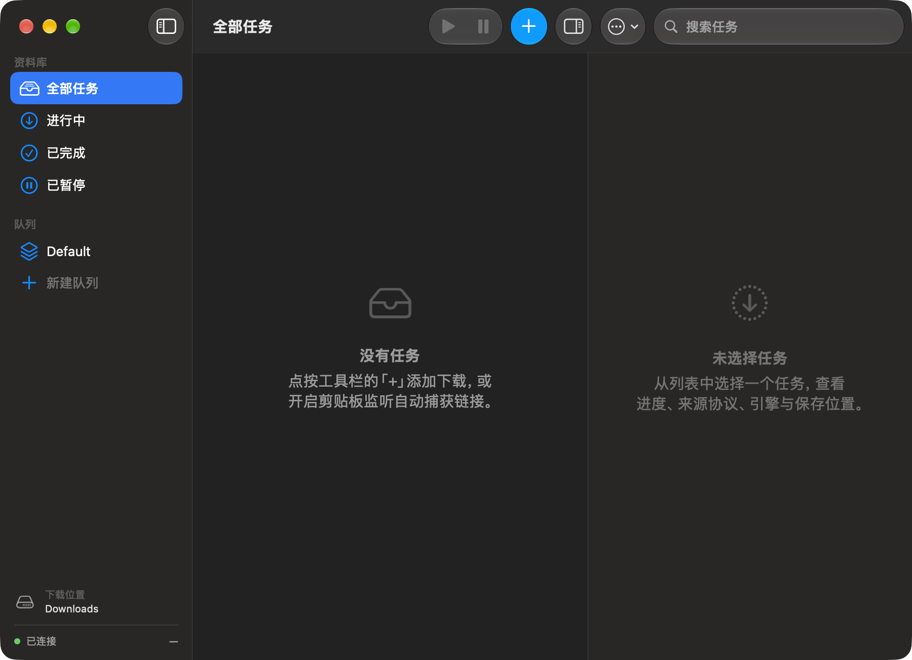

# Siphon · 虹吸

<p align="center">
  
</p>

<p align="center">
  
</p>

面向 macOS 的原生全协议下载管理器。核心思路：**用 aria2 做久经考验的下载内核，用一层 Swift 协议适配把专用链 / 网关 / 系统工具统一成可下载请求，用 SwiftUI/AppKit 做符合 macOS HIG、macOS 26+ 液态玻璃（Liquid Glass）的原生界面。**

> **为什么叫虹吸**：虹吸跨过落差，靠一根连续管道把远端的流体自发引到本处。aria2 是自持内核，多协议与多分段是入流，落盘的单一文件是出流。

- 语言：Swift 6.4（Swift 5.10 工具链兼容模式）
- 最低系统：macOS 14 (Sonoma)；**macOS 26+ 启用完整液态玻璃窗口（红绿灯 + 统一玻璃工具栏），前提是二进制 linked SDK ≥ 26**（由构建脚本保证，见 §7.1）；14/15 自动降级为材质外观（同一二进制）
- 依赖：零第三方 Swift 包。仅系统框架（Foundation / SwiftUI / AppKit / Network / CommonCrypto / Security）
- 外部二进制：`aria2c`（捆绑，运行必需）；系统 `/usr/bin/curl`、`scp`、`rsync`、`mount_*`（按需调用，不捆绑）；`ffmpeg`（可选，用于 fMP4 重封装）
- 许可证：MIT（详见 [LICENSE](LICENSE)）；aria2 以独立进程调用，见 §11

---

## 1. 为什么这样设计

在对比了 aria2、FluxDown、Gopeed、AB Download Manager、Motrix、Persepolis、HyperDM 七个项目后，取舍如下：

| 需求 | 决策 |
|---|---|
| 稳定 + 性能 | aria2（C++，20 年验证）承担主流协议，Swift 只做编排 |
| 小体积 | Swift 原生编译，无 Electron / Flutter / JVM 运行时；aria2c 单文件约 3–5 MB |
| 全协议 | aria2 覆盖 HTTP(S)/FTP/SFTP/BT/Metalink/磁力；原生引擎补 HLS / DASH / eD2K 哈希；适配层补专用链、WebDAV、S3、IPFS、SMB、SCP/rsync、本地文件与批量列表（§2） |
| 真原生 | SwiftUI + AppKit，`.app` bundle，非 WebView 外壳 |
| 集各家所长 | 队列与调度（AB DM / HyperDM）、限速（Motrix / HyperDM）、剪贴板监听（HyperDM）、浏览器/REST 集成（Gopeed / AB DM）、aria2 JSON-RPC（Motrix / Persepolis）、**动态分段 work-stealing（FluxDown）**、**任务事件 Webhook（FluxDown）**、**多 CDN 故障转移（FluxDown）**、**就地扩容 TrueSize 修正（FluxDown）**、**MCP Server（FluxDown / Gopeed）**、**自动归类归档（HyperDM）**、**PAC 代理判定（FluxDown）** |

**许可证关键**：aria2 是 GPLv2。本工程以**独立进程 + JSON-RPC**调用 aria2c，不链接 `libaria2`、不合并二进制，因此应用自身不必 GPL 化。若改为链接 libaria2，需重新评估合规义务。

---

## 2. 协议矩阵

所有输入先经过 `URINormalizer`：专用链解码、网关重写、播放列表展开，产出「URL + 请求头 + 原始协议徽章」。任务层与传输层因此完全解耦 —— 新增一个前端协议只需在适配层加一个 case。

### A. aria2 内核（真实传输）

| 协议 | URI | 说明 |
|---|---|---|
| HTTP / HTTPS | `http:` `https:` | 多连接分段、断点续传、Cookie / 自定义头 |
| FTP | `ftp:` | 被动模式、ASCII/二进制 |
| SFTP | `sftp:` | 本机 aria2 1.37.0 以 libssh2 编译（`Enabled Features: … SFTP`） |
| BitTorrent | `.torrent` / `file://…torrent` | DHT / PEX / WebSeed / 选择性下载；本地种子走 `aria2.addTorrent` |
| Magnet | `magnet:` | `dn=` 推导任务名 |
| Metalink v3 / v4 | `.metalink` `.meta4` | 本地文档走 `aria2.addMetalink` |

### B. Swift 原生引擎

| 协议 | 实现 | 状态 |
|---|---|---|
| HLS `.m3u8` | master/media 播放列表、`EXT-X-KEY` AES-128、`EXT-X-BYTERANGE`、**`EXT-X-MAP` fMP4/CMAF 初始化段** | ✅ TS 与 fMP4 字节流 |
| DASH `.mpd` | SegmentTemplate（`$Number$` / `$RepresentationID$`）、SegmentTimeline、SegmentList，init + segments 有序拼接 | ✅ fMP4 字节流 |
| eD2K `ed2k://` | MD4（RFC 1320 官方向量）、分块哈希、链接解析、下载后校验、`ED2KBackend` 抽象 | ⚠️ P2P 传输后端未接入，见 §5 |

HLS / DASH 共用 `SegmentAssembler`：有界并发、严格有序落盘、按段断点续传、令牌桶限速。

### C. URI 前端（规范化后交给 aria2）

| 协议 | 转换 | 说明 |
|---|---|---|
| 迅雷 / 快车 / QQ旋风 | `thunder://` `flashget://` `qqdl://` → base64 解码出真实 URL | 容忍缺失 padding、`&port` 尾缀、大小写 |
| WebDAV / WebDAVS | `webdav(s)://user:pass@host/path` → `http(s)://…` | 凭据内嵌，由 aria2 做 Basic/Digest |
| IPFS / IPNS | `ipfs://CID/path` → `<网关>/ipfs/CID/path` | 网关可在「设置 → 协议网关」配置；也支持系统 curl 的 `--ipfs-gateway` |
| S3 兼容对象存储 | `s3://bucket/key` → AWS SigV4 预签名 HTTPS URL | AWS S3 / MinIO / R2 / Wasabi / B2；密钥存钥匙串，签名有独立参考向量测试 |

### D. 系统工具桥接（自持、零新增依赖）

| 协议 | 工具 | 说明 |
|---|---|---|
| FTPS / SMB / SMBS | `/usr/bin/curl` | 系统 libcurl 8.7.1 原生支持；`--continue-at -` 续传、`--limit-rate` 限速 |
| TFTP / Gopher / RTSP / DICT / IMAP·POP3·SMTP·LDAP / MQTT | 同上 | 统一归入 `DownloadProtocol.curl` 直通 |
| SCP / rsync | `/usr/bin/scp`、`/usr/bin/rsync` | BatchMode、断点续传、带宽限制 |
| NFS / AFP | `mount_nfs` / `mount_afp` + 复制 + `umount` | 需要本机挂载权限；失败时明确报错而非静默跳过 |

### E. 本地与批量

| 输入 | 实现 | 说明 |
|---|---|---|
| `file://` | Swift 分块复制 | 带进度与限速；aria2 不接受 `file://` 作为下载源 |
| `data:` | RFC 2397 解码 | base64 与百分号编码两种形式 |
| M3U / PLS / ASX / WPL / JSON 数组 / 多行 URL | `PlaylistImporter` 展开为多任务 | 支持 `#EXTINF` 标题、相对路径解析、单次上限 500 条 |

### 未纳入及原因

| 项目 | 原因 |
|---|---|
| eD2K / Kad P2P 传输 | 需要独立内核（服务器登录、源交换、180 KiB 分片、信用系统、Kad DHT）。已留 `ED2KBackend` 接口，见 §5 |
| Usenet / NNTP + NZB + yEnc + PAR2 | 需要 NNTP 订阅账号与 Reed–Solomon 修复实现，属独立子系统 |
| DRM（Widevine / FairPlay / SAMPLE-AES / ClearKey） | 需要许可证服务器与密钥协商，不在通用下载器范围 |
| 网盘私有协议（百度网盘 / 阿里云盘等） | 需账号登录与不断变化的私有签名 API，且不属于公开传输协议 |
| HLS / DASH 直播录制、BT v2 / WebTorrent、HTTP/3 | 需要持续刷新播放列表 / 新版 BT 栈 / QUIC 内核；见 §9 |

> 本机 `aria2c --version` 实测启用 `HTTPS, SFTP, BitTorrent, Metalink`；`curl -V` 实测协议表含 `ftps smb smbs ipfs ipns tftp gopher rtsp …`（不含 sftp/scp，那两者分别由 aria2 与 OpenSSH 承担）。协议声明与实测能力一致。

### 增强能力（借鉴竞品后新增）

| 能力 | 说明 | 来源 |
|---|---|---|
| 动态分段 work-stealing | 协调器按需派发字节区间，慢段在运行时被对半拆分给空闲连接 | FluxDown `segment_coordinator` |
| 任务事件 Webhook | 任务进入完成 / 出错 / 移除终态时 POST JSON（可选 HMAC-SHA256 签名） | FluxDown task-event webhooks |
| 多 CDN 故障转移 | 任务可挂多个镜像 URL，主源失败时依次切换 | FluxDown `multi_cdn` / `route_health` |
| 就地扩容（TrueSize 修正） | 多段下载途中服务器自报总大小变大时延长预分配、追加尾段，已下字节零丢弃（最多 3 次） | FluxDown `MAX_SIZE_EXPANSIONS` |
| MCP Server | 回环 HTTP + JSON-RPC 2.0，暴露 add_download / list_tasks / pause / resume / remove | FluxDown / Gopeed `mcpserver` |
| 自动归类归档 | 按扩展名归入 视频/音乐/图片/文档/压缩包/软件/种子 子目录（可关） | HyperDM `categorizer` |
| PAC 代理判定 | 读系统 PAC/代理设置，用 JavaScriptCore 执行 `FindProxyForURL`，按主机选代理（回环直连） | FluxDown `pac_js` |

---

## 3. 构建与运行

```bash
cd Siphon

# 1) 验证：编译 + 官方向量 + 解析 + 分段装配 + 真实 aria2 RPC + 全协议矩阵端到端
./scripts/verify.sh

# 2) 仅编译
swift build

# 3) 生成可双击运行的 .app（自动捆绑图标、aria2c / ffmpeg 及其依赖库）
brew install aria2            # 若尚未安装
./scripts/build-app.sh
open build/Siphon.app

# 4) 从矢量源重新生成应用图标（改了 scripts/MakeIcon.swift 后执行）
./scripts/make-icon.sh

# 5) 生成可拖拽安装的 DMG（自动挂载校验签名后卸载）
./scripts/make-dmg.sh
```

`build-app.sh` 在缺少 `Resources/AppIcon.icns` 时会自动调用 `make-icon.sh`，因此全新 clone 后一条命令即可得到带图标的 `.app`。安装时把 `build/Siphon.app` 拖进「应用程序」，或挂载 `build/Siphon-0.1.0.dmg` 拖入其中的 Applications 快捷方式；命令行可用 `ditto build/Siphon.app /Applications/Siphon.app`（`ditto` 会保留代码签名与扩展属性）。

`verify.sh` 共 21 步：编译、MD4/eD2K 官方向量（14 项）、HLS/DASH 解析（21 项）、并发有序落盘端到端、**真实 aria2 进程 + JSON-RPC 下载 + 字节校验**（未安装 aria2c 时自动跳过）、**协议矩阵 102+ 条断言**——协议检测全表、专用链解码、M3U/PLS/ASX/WPL/JSON 解析、AWS SigV4（与独立 Python 实现的参考签名逐字节比对）、`EXT-X-MAP`、aria2 选项映射、URI 规范化、`file://` / `data:` / libcurl 三种真实落盘端到端、**迅雷链 → 规范化 → 真实 aria2 → 落盘字节校验**的完整链路，以及新增的 **PAC 解析器**（JavaScriptCore 执行 + 指令解析）与 **MCP JSON-RPC + Webhook 签名/载荷**测试。其中包含三条回归断言：`aria2.tellActive` 只接受可选的 keys 数组，早期误传 `(offset, num)` 会让 RPC 报错并被 `poll()` 吞掉，导致进度轮询整体失效；`ipfs://CID` 规范化不得带尾斜杠（否则网关 404）；分段下载进度必须按字节而非段数上报。三者均已修正并加入自动化验证。

也可直接调试运行（需已在 `Resources/` 或 `~/Library/Application Support/Siphon/` 放置 `aria2c`）：

```bash
swift run Siphon
```

`aria2c` 查找顺序：① App Bundle `Contents/Resources/aria2c` → ② `~/Library/Application Support/Siphon/aria2c` → ③ `PATH` 中查找（Apple Silicon 为 `/opt/homebrew/bin`，Intel 为 `/usr/local/bin`）→ ④ 常见绝对路径。可用 `ARIA2C=/path/to/aria2c ./scripts/build-app.sh` 指定。

**打包脚本已处理的分发细节**（已实测）：
- Homebrew 的 `aria2c` 动态链接 6 个 `/opt/homebrew/opt/*/lib/*.dylib`。`build-app.sh` 会把这些库连同传递依赖复制进 `Contents/Frameworks/`，用 `install_name_tool` 改写为 `@executable_path/../Frameworks/`，产物在无 Homebrew 的机器上也能运行。
- 改写 Mach-O 会使原代码签名失效（内核会以 SIGKILL/137 结束进程），脚本对每个嵌套二进制**逐个重签**后再签整个 bundle，并做 `codesign --verify --deep --strict` 校验。
- `Package.swift` 用 `-platform_version` 把 `LC_BUILD_VERSION.sdk` 固定在 26.0；`build-app.sh` 再用 `vtool` 提升到本机实际 SDK（27.2），否则 macOS 26+ 会把整个窗口 chrome 降级为旧式不透明标题栏与老红绿灯（详见 §7.1）。可用 `vtool -show-build build/Siphon.app/Contents/MacOS/Siphon` 自查。
- 当前实测产物约 **14 MB**（主程序 2.1 MB + 图标 1.7 MB + aria2c 3.2 MB + 依赖库），arm64、adhoc 签名，含 `Contents/Resources/AppIcon.icns`。

> 跨架构分发：当前为 arm64。若需通用二进制，用 `lipo -create` 合成 arm64 + x86_64 的 aria2c 及其 dylib（注意 OpenSSL 等库的架构也要匹配），或分别出两个架构的包。正式发布还需 Developer ID 签名 + 公证 + Hardened Runtime。

---

## 4. 目录结构

```
Sources/Siphon/
  SiphonApp.swift              @main 入口，单窗口 Window + Settings scene + 菜单栏 Commands
  Models/                         协议枚举、任务、进度、状态
  Engines/
    Engine.swift                  统一引擎协议 + 主线程回调协议
    Aria2/                       进程引导、JSON-RPC 客户端、GID 映射与轮询
    Shared/SegmentAssembler.swift  HLS/DASH 共用的并发分段装配器
    Shared/ExternalRunner.swift    外部进程执行器（stdout/stderr 重定向到文件，避免管道死锁）
    HLS/                         m3u8 解析 + AES-128 解密 + TS/fMP4 输出
    DASH/                        MPD 解析 + 初始化段/媒体段
    ED2K/                        MD4、eD2K 哈希、链接解析、传输后端抽象
    External/CurlEngine.swift      libcurl 协议族（FTPS/SMB/TFTP/Gopher/RTSP…）
    External/SystemTransferEngine.swift  SCP/rsync + NFS/AFP 挂载桥接
    Local/LocalEngine.swift        file:// 复制、RFC 2397 data: URI
  Protocols/                      协议适配层
    URINormalizer.swift           统一入口：解码、网关重写、批量展开
    SpecialLinks.swift            迅雷 / 快车 / QQ旋风 专用链
    PlaylistImporter.swift        M3U/PLS/ASX/WPL/JSON/多行列表
    S3Signer.swift                AWS SigV4 预签名（CommonCrypto）
    ProtocolSettings.swift        网关配置 + S3 密钥存钥匙串
    PACResolver.swift             PAC 脚本解析 + JavaScriptCore 执行 FindProxyForURL
    ProxyRouter.swift             读系统代理/PAC，按主机选代理（回环直连，默认关闭）
  Managers/
    DownloadStore.swift          任务路由、状态聚合、持久化（主数据源）
    QueueManager.swift           命名队列、并发/顺序模式、下载时段窗口
    SpeedLimitController.swift   令牌桶（原生引擎）+ aria2 全局限速转发
    ClipboardMonitor.swift       剪贴板链接捕获
    WebhookManager.swift         任务终态事件 Webhook（JSON POST + HMAC-SHA256 签名）
  BrowserExtension/
    NativeMessagingServer.swift  本地 HTTP 控制接口（NWListener, 127.0.0.1:17801）
    MCPServer.swift              MCP 服务（JSON-RPC 2.0, 127.0.0.1:17802，AI 客户端管理下载）
  Views/
    Glass.swift                   浮层控件的玻璃自适应组件（26+ 玻璃 / 14–15 材质回退）
    ContentView.swift            两栏布局 + 系统可折叠检查器 + 统一工具栏分组 + 搜索
    TaskListView.swift           任务列表（纯内容层，无悬浮条）
    ...                          侧栏 / 检查器 / 设置 / 表单
Resources/
  UI-Preview.png                 真实窗口截图：新版红绿灯 + 顶部玻璃工具栏（macOS 27.2，深色模式）
  AppIcon.icns                   打包进 .app 的图标（Info.plist 以 CFBundleIconFile 引用）
  AppIcon-1024.png               1024 不透明主图（App Store 规格，无 alpha 通道）
  AppIcon-Preview.png            圆角 + 阴影的访达效果预览
  AppIcon.iconset/               10 个按原生分辨率渲染的 PNG
  Assets.xcassets/AppIcon.appiconset/   Xcode 可直接使用的 asset catalog
  Info.plist                     18 种 URL scheme、文档类型、最低系统版本
  BrowserExtension/              Manifest V3 扩展示例
  TestLinks/                     各协议公开自测链接 + M3U / JSON / Meta4 夹具
scripts/
  build-app.sh                   release 编译 + .app 组装 + SDK 标记提升 + dylib 重链接 + 重签名
  make-dmg.sh                    可拖拽安装的 DMG（含挂载后签名校验）
  make-icon.sh / MakeIcon.swift  矢量图标生成器
  verify.sh                      6 组可复现验证
Tests/                           向量、解析、协议矩阵与端到端测试
  ProtocolTests/                 协议适配与 file/data/libcurl 真实落盘
```

---

## 5. eD2K：已完成什么、还差什么

**已实现且经测试验证**：纯 Swift MD4（RFC 1320，7/7 官方向量通过）、eD2K 分块哈希（9,728,000 字节分块）、流式哈希、`ed2k://` 链接解析（文件名/大小/哈希/sources）、下载后哈希校验、以及 `ED2KBackend` 传输抽象。

**未实现**：真正的 P2P 传输。完整 eD2K 客户端需要服务器登录与 ID 分配、按哈希搜索、源交换（server ↔ peer）、peer 握手、180 KiB 分片请求、信用系统，以及 Kad DHT 找源。这属于独立内核，不可能在 UI 脚手架里"顺手"正确实现。`ED2KEngine` 默认使用 `UnavailableED2KBackend`，会明确报错并说明原因，**不会伪装成下载成功**。

接入路径（任选其一，实现 `ED2KBackend` 协议即可，UI 与任务层无需改动）：

1. **libed2k**（推荐）：C++ 库，提供 ed2k session / transfer。用 Objective-C++ 桥接或 C ABI 包装，映射 `connect()` / `download(_:destination:onProgress:)` / `cancel(fileHashHex:)`。
2. **aMule 守护进程**：以 `amulecmd` 或 EC 协议驱动，Swift 侧做进程与协议适配。
3. **自研 Kad/ED2K 栈**：工作量最大，仅在需要完全自持时考虑。

可参考同工作区 `FluxDown-main/native/engine` 的 eD2K 实现（Rust，AGPL-3.0）了解协议分层；若借鉴其代码需注意 AGPL 的传染性。

---

## 6. HLS / DASH 的已知边界

- **HLS**：TS 播放列表输出按序拼接的 MPEG-TS；带 `EXT-X-MAP` 的 fMP4/CMAF 播放列表会先写入初始化段再按序写入 moof/mdat 分片（初始化段不参与 AES 解密，IV 序号相应偏移）。输出是有效 fragmented-MP4 字节流，不是带扁平 `moov` 的通用单文件 MP4。
- **DASH**：输出为 `init + segments` 的 fMP4 字节流，可被支持 fragmented MP4 的播放器读取；生成通用单文件 MP4 需 `ffmpeg -i in.mp4 -c copy out.mp4`。
- **DRM**（Widevine / FairPlay / ClearKey 等）不在范围内。
- **直播流**（无 `EXT-X-ENDLIST` / 动态 MPD）目前按快照处理；持续录制需扩展为轮询播放列表。
- 若捆绑了 `ffmpeg`，可在落盘后加一步重封装以获得最佳兼容性。

---

## 7. 窗口框架与液态玻璃 UI（macOS 26+）

### 7.1 关键：链接 SDK 决定窗口 chrome 代际

macOS 26+ 不只看系统版本，还看主可执行文件 `LC_BUILD_VERSION` 的 **sdk 字段**来决定是否给 app 新版窗口外观。SwiftPM 会把部署目标同时写进 `minos` 和 `sdk`：`platforms: [.macOS(.v14)]` 产出的二进制是 `minos 14.0 / sdk 14.0`，即便用 Xcode 27 SDK 编译、跑在 macOS 27 上，AppKit 仍会**降级成不透明旧标题栏 + 老式红绿灯**。这不是控件画得不够，而是整个 chrome 被系统换掉了。

修复分两层，均已固化：

| 位置 | 做法 |
|---|---|
| `Package.swift` | `linkerSettings: [.unsafeFlags([... "-platform_version", "macos", "14.0", "26.0"])]`，让 `swift build` / `swift run` 的二进制声明 sdk ≥ 26 |
| `scripts/build-app.sh` | 打包时用 `vtool -set-build-version macos <minos> $(xcrun --show-sdk-version) -replace` 提升到实际 SDK（本机 27.2），再统一重签 |

自查：

```bash
vtool -show-build build/Siphon.app/Contents/MacOS/Siphon | grep -E 'minos|sdk'
# minos 14.0 / sdk 27.2  ← 新版红绿灯与玻璃工具栏生效
```

实测对比：仅把 sdk 从 `14.0` 改成 `27.2`（UI 代码零改动），红绿灯即从实心圆变成带玻璃圆形底座的新样式，侧栏开关与顶部按钮自动合并进系统玻璃胶囊，失焦时整套玻璃按系统规则变灰。

### 7.2 系统 chrome 不手绘

| 规则 | 落地 |
|---|---|
| 窗口控件由系统绘制 | 红绿灯、圆角、统一标题栏、侧栏玻璃全部交给 AppKit；不叠加自定义背景、描边、着色或 `.glassEffect` |
| 工具栏玻璃由系统绘制 | 只用标准 `ToolbarItem` / `ToolbarItemGroup` / `Menu` / `.searchable`；Apple 明确要求移除栏后自定义背景，否则破坏滚动边缘效果 |
| 玻璃只属于浮层控件 | 任务列表、正文、进度条、检查器 `Form` 保持不透明；自定义玻璃仅用于行内圆形按钮与表单中的浮层控件（`Glass.swift`） |
| 空状态用系统组件 | `ContentUnavailableView`，不再自绘玻璃卡片 |
| 侧栏底部用普通内容 | 侧栏本身已是玻璃，再叠玻璃卡片会双重合成；下载位置与引擎状态改为纯文本行 |
| 滚动边缘柔化 | `.scrollEdgeEffectStyle(.soft, for: .top)` |
| 微小元素不用玻璃 | 协议徽章保留彩色胶囊，避免失去对比度 |

### 7.3 顶部统一工具栏（HIG 分组）

所有全局操作从原来的**底部悬浮命令条**收回到窗口顶部 —— macOS 没有底部工具栏这一惯例：

- **前缘**：系统侧栏开关（独立玻璃胶囊）+ 当前资料库标题（`.navigationTitle`，不用 app 名作窗口标题）
- **中间**：传输控制 `[恢复全部][全部暂停]`，一个 `ToolbarItemGroup` 形成一组
- **后缘**：`[+ 新建下载]`（唯一 `.borderedProminent` + `tint`，蓝色独立胶囊）、`[检查器]`、`[更多操作]` 菜单，再由系统 `.searchable` 提供独立玻璃搜索字段
- 组间用 `ToolbarSpacer(.fixed, placement: .primaryAction)` 分隔（macOS 26+ API，必须与被分隔项同 placement 才生效）
- `SiphonCommands` 让每个工具栏动作在菜单栏都有对应项（⌘N、「任务」菜单），因为工具栏可被隐藏或自定义

搜索作用于整个 `NavigationSplitView`，按任务名 / 规范化后 URL / 原始专用链 / 协议名过滤。检查器列不再声明自己的 `.toolbar`，避免向窗口工具栏注入未分组的第四组。

### 7.4 可折叠的右侧检查器

早期实现用三栏 `NavigationSplitView` 的 `detail` 列放详情，工具栏按钮只切换**列里显示的视图**。该列本身无法隐藏，且未选中任务时开/关都显示同一个空状态 —— 表现为「点了没反应」。现在改成两栏 `NavigationSplitView`（侧栏 + 任务列表）加系统 `.inspector(isPresented:)`（macOS 14+）：AppKit 负责分隔线、折叠动画与玻璃背景，`isPresented` 才是真正的开关。`showingInspector` 用 `@AppStorage` 持久化，工具栏按钮、⌘⌥I 与「任务」菜单的 Toggle 共享同一状态；「剪贴板监听 / 本地控制接口」两个开关同样改为重启后保留。

**兼容性**：部署目标仍是 macOS 14。`glassEffect`、`ToolbarSpacer` 等 26 API 全部收敛在 `if #available(macOS 26.0, *)`；14/15 回退到 `Material`、`.bordered` 按钮与标准工具栏，单一二进制覆盖两代外观。

**单窗口**：入口用 `Window` 而非 `WindowGroup`，避免每个 `magnet:` / `ed2k:` 链接新建窗口叠影，并消除默认「新建窗口」与 ⌘N 的冲突。

> 实测环境 macOS 27.2：用真实窗口截图验证空状态、双任务状态、失焦状态，确认分组胶囊、蓝色主操作、搜索字段、无底部悬浮条遮挡、列表无幽灵行。图标仍是标准兼容 `.icns`（系统自动套圆角）；Apple 的分层玻璃图标需 Icon Composer 生成 `.icon`，本机无该工具，故未包含。

---

## 8. 本地控制接口

设置 → 集成 → 开启后监听 `127.0.0.1:17801`：

```bash
curl -X POST http://127.0.0.1:17801/add \
     -H 'Content-Type: application/json' \
     -d '{"url":"https://example.com/file.zip"}'

curl http://127.0.0.1:17801/ping
```

`Resources/BrowserExtension/` 提供可直接「加载已解压的扩展程序」的 Manifest V3 示例。仅绑定回环地址，不监听公网。「自动捕获复制的下载链接」与「启用本地控制接口」两个开关的状态会持久化，重启后自动恢复。

### 8.1 各协议公开自测链接

`Resources/TestLinks/siphon-test-links.txt` 收录可直接粘贴到「新建下载」的公开链接，按协议分组；同目录还有 `siphon-test.m3u`（批量列表）、`siphon-test.json`、`siphon-test.meta4`（Metalink）。专用链是把其中的 W3C `dummy.pdf` 按 `AA/ZZ` 等规则编码而来，Magnet 的 infohash 由 WebTorrent 公开的 Sintel torrent 实际算出。

在 macOS 27.2 上通过本地控制接口把 14 类链接喂进真实 App 实测：HTTPS / FTP / 带凭据 SFTP / 迅雷链 / `data:` / `file://` / WebDAV 网关 / IPFS 网关 / HLS（本地与 Apple 公开流）/ DASH / Metalink / M3U 批量全部 `completed` 并校验字节；Magnet 保持 `active`（等待 DHT / peer，属正常）。测试也发现并修掉了两个真实缺陷：`ipfs://CID` 规范化多带尾斜杠导致网关 404；HLS/DASH 把「段数」当「字节数」上报，使 1.4 MB 的流显示成 `180/180`。

需要自备服务端或凭据的协议无法用公开匿名链接覆盖：SMB / NFS / AFP（需本机共享或挂载）、S3（需在「设置 → 协议网关」填密钥）、eD2K（目前只有哈希与链接解析，无 P2P 传输后端）、DRM 与网盘私有协议。公共 IPFS 网关（`ipfs.io`、`dweb.link`、`cloudflare-ipfs.com` 等）在本机网络下均超时，需在设置里换成自己可达的网关。

---

## 9. 后续路线建议

1. 接入 `ED2KBackend`（libed2k / aMule）以完成 eD2K 传输闭环
2. 增加 `ffmpeg` 重封装管线，统一 HLS/DASH 输出为标准单文件 MP4
3. Usenet：NNTP over TLS + NZB + yEnc + PAR2 修复
4. HLS/DASH 直播录制（播放列表轮询）、BT v2 / WebTorrent、HTTP/3
5. WebDAV 目录浏览与上传（PROPFIND 递归）；当前支持单文件下载
6. aria2 由 HTTP 轮询改为 WebSocket 通知，降低延迟
7. 任务持久化从 UserDefaults 迁到 SQLite（WAL），支持崩溃恢复与段级续传记录
8. 沙盒 + Hardened Runtime + Developer ID 签名与公证
9. 增加 BT 文件选择、Tracker 管理、RSS 订阅与下载完成脚本

---

## 10. 应用图标

`scripts/MakeIcon.swift` 是唯一的矢量源（CoreGraphics），`./scripts/make-icon.sh` 生成全部产物。设计遵循 macOS Big Sur+ 应用图标规范：

- **方形、不透明、不自带圆角**：由系统统一套用连续曲率圆角遮罩；已用 `NSWorkspace` 解析 `Siphon.app` 实测，系统渲染出的图标自动带圆角且无裁切
- **主体位于安全区**：单一白色圆润下载符号（箭头 + 落点横条），四周留白约 20%，不含任何文字
- **层次克制**：青蓝 → 靛蓝 → 紫的对角渐变、左上柔光、顶部玻璃高光、极淡的斜向流线（呼应「虹吸」），符号一次柔和投影
- **每个尺寸独立渲染**：16 / 32 / 128 / 256 / 512 及各自 @2x 共 10 张，而非从 1024 缩放；`<64px` 自动简化（去掉托盘与阴影、加粗笔画、纯白主体），菜单栏与列表视图下仍可辨识
- **主图无 alpha 通道**：`AppIcon-1024.png` 由纯 `CGContext` 输出 RGB；`.icns` 经 `iconutil` 生成并已往返校验 10 个尺寸齐全

除图标资源外，仓库还附带 `Resources/Assets.xcassets/AppIcon.appiconset/`，可直接用 Xcode 打开。

> macOS 26 的**分层玻璃图标**需要 Apple Icon Composer 产出的 `.icon` bundle（含玻璃层与 Clear / Dark / Tinted 变体）。当前交付的是标准不透明 `.icns`，系统会自动套用圆角；本机未安装 Icon Composer CLI，因此没有生成 `.icon`。这与 §7 的界面液态玻璃是两件事。

---

## 11. 许可证与第三方

本仓库 Swift 源码采用 **MIT**（见 [LICENSE](LICENSE)）。aria2 为 **GPLv2**，**不随本仓库分发**：Siphon 以独立进程 + JSON-RPC 调用 `aria2c`，不链接 `libaria2`、不合并二进制，因此应用自身不必 GPL 化。

`build-app.sh` 会从本机 Homebrew 复制 `aria2c` 及其依赖库到 `.app` 中；**再分发该 `.app` 时需自行履行 aria2 的 GPLv2 义务**（提供对应源码，或仅分发上游未修改二进制）。可选的 `ffmpeg` 同理，其许可证取决于构建配置。若将来改为链接 `libaria2`，需重新评估合规义务。
